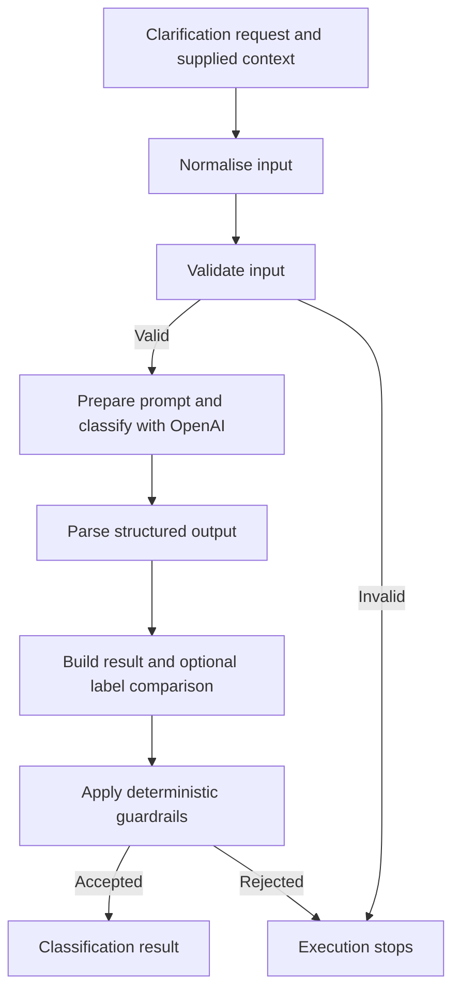

# AI clarification routing with n8n

Manufacturing suppliers often need clarification about drawings, materials, tolerances and manufacturing instructions. Existing evidence can answer some questions; others need specialist interpretation or a new customer decision. This proof of concept uses n8n and an OpenAI model to interpret and route those requests using supplied context. Deterministic validation and guardrails constrain the accepted result, while separate evaluations examine classification behaviour and potential routing opportunity. All examples and historical labels are synthetic.

## Architecture

The manual sample and callable classifier share the following pipeline:



The prompt is assembled from caller-supplied context; the workflow does not retrieve documents. Parsing or model errors can also stop execution. See [architecture](docs/architecture.md) for details.

## Classification outcomes

- **Resolved:** supplied evidence explicitly answers the question without a new decision.
- **Assisted:** relevant evidence exists, but ambiguity, conflict or another technical issue needs specialist review.
- **Customer Required:** a customer decision, approval, deviation acceptance or missing information is needed.

## Design decisions

**AI interpretation, deterministic control.** Natural-language requests and technical context vary, so the model interprets them and proposes a route. Code validates required inputs and status values before the call and checks the returned result afterward. These checks constrain the output; they cannot prove its semantic correctness.

**Three routes reflect different responsibilities.** Resolved identifies an answer already present in supplied evidence. Assisted sends an ambiguity or conflict to a specialist; Customer Required identifies a decision or information that must come from the customer. Keeping those routes separate avoids treating technical review and customer escalation as the same action.

**Structured output supports validation.** The parser specifies a classification, reason, missing evidence and proposed action. Guardrails reject empty output fields, invalid classifications, and Resolved or Assisted results without a caller-declared processed attachment or retrieved order context. The prompt also instructs the model not to invent evidence, choose unsupported interpretations or approve customer decisions; those instructions are not deterministic guarantees. A rejection stops execution rather than automatically rerouting the case.

**Functional evaluation and historical KPI answer different questions.** Labelled examples let the batch workflow compare classifications and report guardrail status for returned cases. A separate calculation measures potential routing opportunity from previously assigned retrospective labels; it does not call the model or measure its accuracy.

**Human judgement remains necessary.** Customer decisions and unsupported technical conflicts require the appropriate customer or specialist, not an automatic approval or invented resolution.

## Workflows

- `workflows/00-n8n-smoke-test.json`: local n8n smoke test.
- `workflows/01-ai-clarification-review.json`: manual sample and callable classifier.
- `workflows/02-batch-evaluation.json`: processes labelled cases sequentially through the classifier and summarises agreement and guardrail status.
- `workflows/03-historical-deflection-kpi.json`: aggregates retrospective route labels without calling the model.

## Local setup

Requires Docker and Docker Compose v2. The configured `latest` n8n image has started in the destination environment, but its precise version is unverified and unpinned; future compatibility is not established.

1. Run `./dev check` and `./dev start`, then open http://localhost:5678 (`./dev open` on a desktop with `xdg-open`). Ensure port 5678 is free first. Compose uses a project-specific volume and binds the web port to localhost.
2. Create a local n8n owner account and an OpenAI credential in n8n. Never commit credentials or use another environment's data.
3. Import workflows 00, 01, 02 and 03 through n8n's workflow menu. Select the local credential in Workflow 01's **OpenAI Chat Model** node.
4. In Workflow 02's **Classify Evaluation Case** node, select the imported Workflow 01. The export has no instance-specific workflow reference. Save the workflows.
5. Execute Workflow 00 to check n8n, Workflow 01 for the fictional sample, Workflow 02 for the functional suite, and Workflow 03 for the historical KPI. Inspect each final node's output and execution errors. Workflows 01 and 02 call OpenAI and may incur costs.

`./dev help` lists the helper commands. `./dev stop` preserves the named volume, including credentials and execution history. The evaluation directory is mounted read-only at `/files/evaluation`; use the n8n interface to export results if required.

## Evaluation

`python3 scripts/validate-data.py` checks fixture shape, allowed values, coverage and unique identifiers. The functional suite contains 15 synthetic cases, five per route. Static validation and isolated deterministic logic checks have passed, but the replacement suite has **not been executed end-to-end** and no accuracy result is claimed. After local configuration, Workflow 02 can run the suite. A workflow error or guardrail rejection can stop the batch before its summary; inspect the failing execution. See [evaluation](docs/evaluation.md).

The historical workflow uses six synthetic retrospective labels and calculates `(potential_resolved + potential_assisted) / eligible cases * 100`. Every supplied row is treated as eligible, including indeterminate cases. This illustrates the arithmetic, not observed savings or production deflection.

## Limitations

This is a proof of concept. Evidence status is asserted by the caller; sources are not independently verified and attachments are not processed. Guardrails do not establish provenance or semantic correctness, and the small synthetic suite cannot establish production accuracy. Deployment would require additional controls, including human review, access controls, monitoring and representative evaluation; see [production considerations](docs/production-considerations.md).

## Repository structure

```text
workflows/    Four n8n workflow exports
evaluation/   Synthetic functional cases and retrospective labels
examples/     Synthetic example requests
scripts/      Fixture validation
docs/         Architecture, evaluation and production considerations
dev           Docker Compose helper
docker-compose.yml
```
