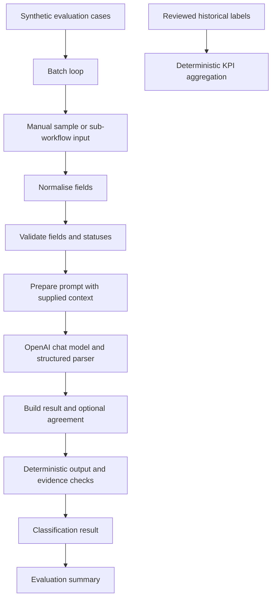

# Architecture

Workflow 01's manual and callable triggers converge on the same pipeline. Preparation keeps expected labels for scoring but the model prompt contains only the request and supplied context. The parser specifies the three classifications and required output strings. The result node compares the expected label when present. Guardrails reject empty outputs, invalid classifications, and Resolved or Assisted without processed attachment or retrieved order context. Input validation rejects missing fields and unsupported statuses. Neither component establishes source authenticity, document precedence, or semantic grounding; these remain model instructions and human review responsibilities.

Workflow 02 reads the mounted JSON, processes cases individually, calls Workflow 01 and summarises returned results. Workflow 03 reads the mounted CSV and validates and counts the retrospective labels without calling Workflow 01 or OpenAI. It counts all supplied rows as eligible, including indeterminate labels. Eligibility and historical labels must be established before aggregation.
